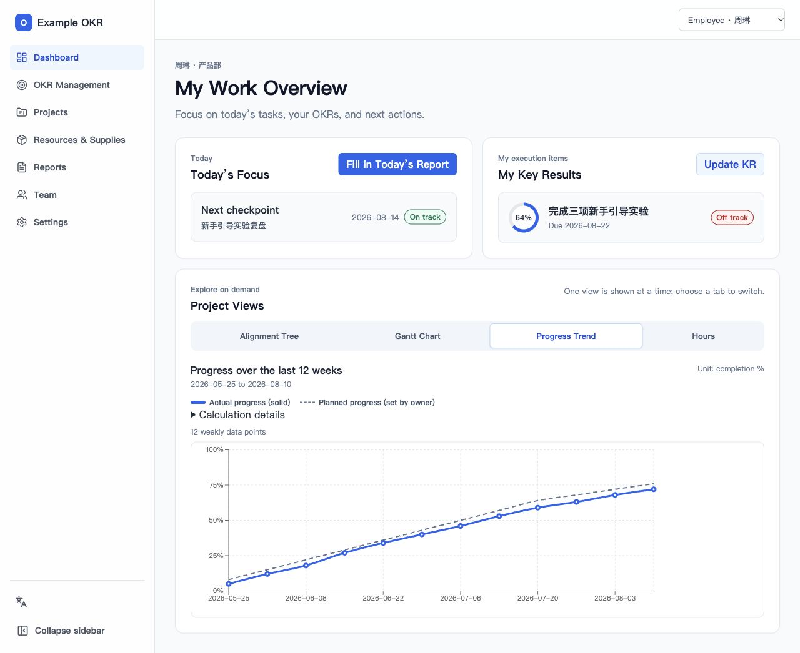
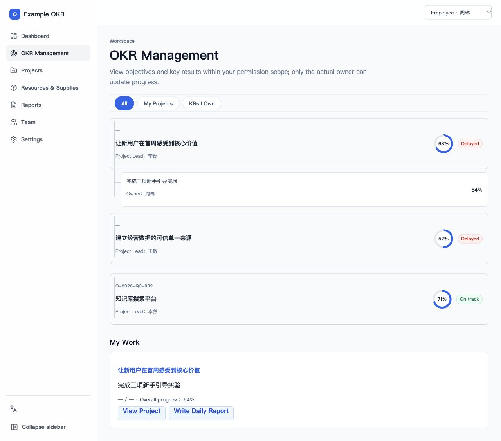
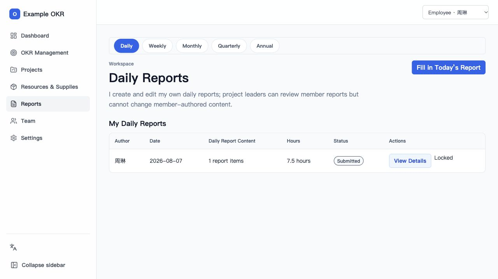

# Example OKR

**Connect objectives to daily evidence, with clear ownership and scoped review.**

Example OKR is a bilingual workspace for teams that need to explain how daily work contributes to key results, distinguish planned progress from actual results, and review work without giving every role access to every report. Explore the included fictional organization locally without a database, email account, or cloud deployment.

## Why choose Example OKR?

The strongest reason to choose this project is its combination of execution traceability, explicit review rules, and an inspectable implementation.

| Design choice | What your team gets | See how it works |
| --- | --- | --- |
| **Daily work connected to KRs** | Structured reports, recorded hours and supporting evidence give reviewers context behind a progress update. | [Reporting workflow](docs/user-guide.en.md#8-daily-reports-review-notifications-and-export) |
| **Separate planned and actual progress** | Project Leaders maintain the plan; KR owners record actual progress with a date and note. Changing a forecast does not rewrite the owner's progress history. | [Progress ownership](docs/user-guide.en.md#2-update-my-kr-real-traceable-actual-progress) |
| **Review access follows responsibility** | Direct Project Leaders review authorized report blocks. HR can review work hours without general access to report narratives; account administration alone does not grant business-review authority. | [User guide](docs/user-guide.en.md), [security model](#security-model) |
| **Permissions you can inspect and test** | Database policies and restricted operations are included alongside tests, so teams can examine and adapt how access is enforced. | [Supabase setup](docs/supabase-setup.md), [verification record](docs/deployment-verification.md) |
| **A cloud-free first run** | Anyone evaluating a fork can explore sample workflows and switch roles before setting up persistent storage, email or file services. English and Chinese interfaces are included. | [Run the local demo](#local-demo--no-external-services-required) |

**A concrete example:** an employee records a KR's actual progress with a dated note and submits daily work with hours and evidence. The Project Leader maintains a separate planning baseline and reviews the report blocks within their responsibility. HR reviews work hours through its own view. The resulting workflow preserves the distinction between what was planned, what was reported, and who can review it.

### Where it is a better fit

- **Moving beyond a spreadsheet or OKR template:** choose it when progress ownership, history and review access need to be application rules rather than manually maintained conventions.
- **Building a team-specific execution workflow:** choose it when KR updates, daily reporting, hours and scoped review need to work together in one adaptable application.
- **Evaluating a self-hosted implementation:** choose it when being able to inspect the data model, authorization rules and tests matters, and your team can operate its own services for persistent use.

Goal linking and regular updates are also available in established products such as [Asana](https://help.asana.com/s/article/setting-and-tracking-progress-towards-goals) and [Lattice](https://lattice.com/platform/goals/okrs). Example OKR's positioning is the specific workflow above, supported by runnable source and verification records. No comparative performance, cost or security benchmark has been conducted.

Example Company / 示例公司 and all example domains, accounts and cloud resource names are fictional placeholders. See [public example and release notes](docs/public-example.md) for the example-data boundaries. Hosted example services have not been deployed or verified.

For detailed product guidance, see the [English user guide](docs/user-guide.en.md) or the [Chinese user guide](docs/user-guide.zh-CN.md).

## Screenshots

### Role-based dashboard



### OKR management



### Daily reports



## Key Features

- Role-based dashboards for administrators, management, project leaders, employees, and HR.
- Objective and key-result lifecycle management with ownership, progress history, status, and permission-aware views.
- Project planning views including alignment trees, Gantt charts, progress trends, and recorded work hours.
- Structured daily, weekly, monthly, quarterly, and annual reporting workflows.
- Resource and supply management with attachments and issue tracking.
- HR work-hour review and organization-level user and role administration.
- In-app notifications and instant English/Chinese interface switching.
- Supabase-backed authentication, persistence, restricted RPCs, and row-level security.
- Private attachment transfer through presigned Alibaba Cloud OSS URLs, with attachment metadata retained in PostgreSQL.

## Technology Stack

- React, TypeScript, React Router, and Vite
- Recharts for operational visualizations
- Supabase Auth and PostgreSQL with row-level security
- Express attachment API and Alibaba Cloud OSS
- Vitest and Testing Library

## Local Demo — No External Services Required

Use **Node.js 24.11.0** (the version in `.nvmrc`) and its bundled npm. If you use nvm, run `nvm install` and `nvm use` first. Clone your fork, open a terminal in its project directory, then run:

```bash
npm ci
cp .env.example .env.local
npm run dev
```

Open the local URL printed by Vite. The default example configuration uses demo mode. You do **not** need to deploy a website, create a database, configure email, run the attachment server, or provide Supabase/OSS credentials.

Use the role selector above the dashboard to explore the included sample identities. Demo edits live only in memory and reset on refresh. Files are not uploaded, and real account registration, password recovery, email delivery, and production authorization are not exercised by this mode.

### Using Your Own Data

Switching to `supabase` mode is a separate setup path. It requires your own database with the repository migrations applied, Auth configuration and an initial organization/administrator. Email verification and password recovery require working Auth email delivery. Real attachments additionally require private OSS storage and the attachment API; resource notification emails use a separate server-side email provider configuration.

Follow the [fresh-install guide](docs/supabase-setup.md) for your own hosted Supabase project, initial administrator, Auth email, attachment API and optional resource emails. Server and function examples are in `.env.server.example` and `.env.functions.example`. Live SMTP, Resend and OSS delivery require your own credentials and must be checked separately; see the [verification record](docs/deployment-verification.md) for tested local database/Auth flows and the remaining production checks.

## Application Modes

Choose one mode in `.env.local`:

```dotenv
# In-memory identities and sample data
VITE_APP_MODE=demo

# Supabase authentication and persistent application data
VITE_APP_MODE=supabase
VITE_SUPABASE_URL=
VITE_SUPABASE_ANON_KEY=
```

`demo` mode keeps its data in the current page session and never uploads files. `supabase` mode requires a valid project URL and publishable/anonymous key. Never expose a service-role key or database password in the frontend environment.

## Security Model

Frontend navigation and controls improve the user experience, but they are not the authorization boundary. In Supabase mode, PostgreSQL row-level security, restricted RPCs, and attachment authorization checks validate every protected read or write. Daily-report content, evidence, and attachments are treated as separately permissioned resources.

Attachment binaries are uploaded directly to private Alibaba Cloud OSS objects through short-lived signed URLs. PostgreSQL stores the application metadata, ownership, object path, state, checksum, media type, and size. The attachment API keeps OSS credentials and the Supabase service-role key on the server only.

## Verification

GitHub Actions runs these checks plus the attachment server build on pushes and pull requests, using the Node version in `.nvmrc` and no production credentials. Database checks below are separate and require a local Supabase environment.

```bash
npm run verify:config
npm run test:smoke:real
npm run test:run
npm run typecheck
npm run build
```

Database changes can additionally be checked in an isolated local Supabase environment (Docker required). The reset command destroys that local test database; never reset a production database:

```bash
npm exec supabase -- start
npm exec supabase -- db reset --local
npm exec supabase -- test db
npm exec supabase -- db lint --local
```

## Deployment Notes

Create the production frontend with:

```bash
npm run build:production
```

The build reads the standard Vite production environment files, with deployment-injected variables taking precedence, and writes the static application to `dist/`. Serve it as a single-page application and route `/api/attachments` and `/api/resource-attachments` to the separately built attachment API.

The attachment API requires server-only Supabase and OSS configuration, including `SUPABASE_URL`, `SUPABASE_ANON_KEY`, `SUPABASE_SERVICE_ROLE_KEY`, `OSS_ACCESS_KEY_ID`, `OSS_ACCESS_KEY_SECRET`, `OSS_BUCKET`, `OSS_REGION`, and `OSS_ENDPOINT`. Build and run it with:

```bash
npm run server:build
npm run server:start
```

See the [Supabase and deployment guide](docs/supabase-setup.md) for database setup, production checks, backups, and operational procedures.
