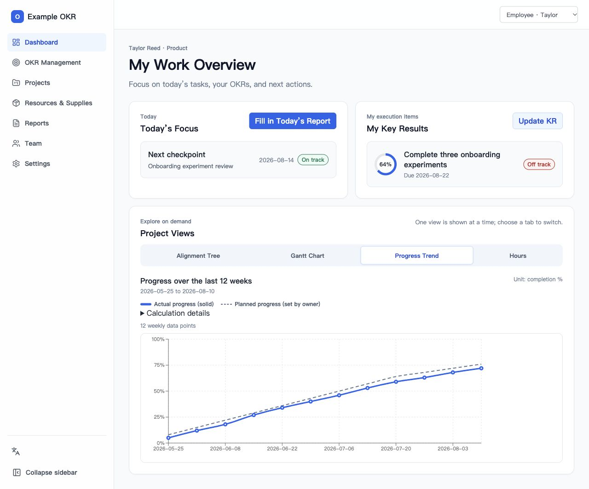
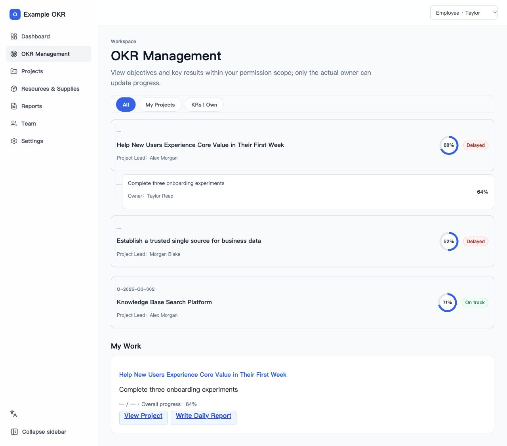
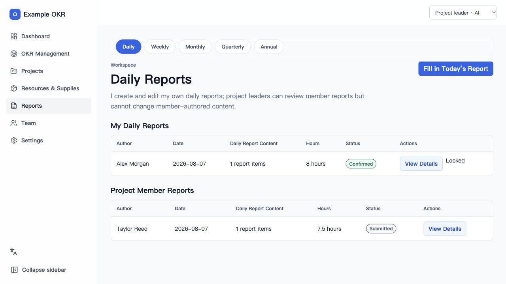

# Example OKR

**Connect objectives to daily evidence, with clear ownership and scoped review.**

Example OKR is a bilingual workspace for teams that need to explain how daily work contributes to key results, distinguish planned progress from actual results, and review work without giving every role access to every report. Explore the included fictional organization locally without a database, email account, or cloud deployment.

**[Try the live demo](https://starinaclytie.github.io/example-okr/)** · [Quick start](#local-demo--no-external-services-required) · [Screenshots](#screenshots) · [Installation guide](docs/supabase-setup.md) · [User guide](docs/user-guide.en.md)

### A one-minute walkthrough

1. Open the demo as **Employee** and inspect an owned KR under **OKR Management**.
2. Switch to **Project Leader** to compare planning and review views, then **HR** to inspect its work-hour view.
3. Use the navigation language control to switch between English and Chinese. The public demo opens in English and uses fictional English names, departments, and business examples. Your language choice is remembered; real user-entered content is never automatically translated.

Demo edits reset when you refresh. Sample dates are illustrative. The hosted demo uses `#/…` links so that shared pages and refreshes work on static hosting.

## Why choose Example OKR?

The strongest reason to choose this project is its combination of execution traceability, explicit review rules, and an inspectable implementation.

| Design choice | What your team gets | See how it works |
| --- | --- | --- |
| **Daily work connected to KRs** | Structured reports, recorded hours and supporting evidence give reviewers context behind a progress update. | [Reporting workflow](docs/user-guide.en.md#8-daily-reports-review-notifications-and-export) |
| **Separate planned and actual progress** | Project Leaders maintain the plan; KR owners record actual progress with a date and note. Changing a forecast does not rewrite the owner's progress history. | [Progress ownership](docs/user-guide.en.md#2-update-my-kr-real-traceable-actual-progress) |
| **Review access follows responsibility** | Direct Project Leaders review authorized report blocks. HR can review work hours without general access to report narratives; account administration alone does not grant business-review authority. | [User guide](docs/user-guide.en.md), [security model](#security-model) |
| **Permissions you can inspect and test** | Database policies and restricted operations are included alongside tests, so teams can examine and adapt how access is enforced. | [Supabase setup](docs/supabase-setup.md), [verification record](docs/deployment-verification.md) |
| **A cloud-free first run** | Anyone evaluating a fork can explore sample workflows and switch roles before setting up persistent storage, email or file services. English and Chinese interfaces are included. | [Run the local demo](#local-demo--no-external-services-required) |

**A concrete example:** an employee records a KR's actual progress with a dated note and submits daily work with hours and evidence. The Project Leader maintains a separate planning baseline and reviews the report blocks within their responsibility. HR reviews work hours through its own view. The resulting workflow preserves the distinction between what was planned, what was reported, and who can review it.

### Where it is a better fit

- **Moving beyond a spreadsheet or OKR template:** choose it when progress ownership, history and review access need to be application rules rather than manually maintained conventions.
- **Building a team-specific execution workflow:** choose it when KR updates, daily reporting, hours and scoped review need to work together in one adaptable application.
- **Evaluating a self-hosted implementation:** choose it when being able to inspect the data model, authorization rules and tests matters, and your team can operate its own services for persistent use.

Goal linking and regular updates are also available in established products such as [Asana](https://help.asana.com/s/article/setting-and-tracking-progress-towards-goals) and [Lattice](https://lattice.com/platform/goals/okrs). Example OKR's positioning is the specific workflow above, supported by runnable source and verification records. No comparative performance, cost or security benchmark has been conducted.

Example Company / 示例公司 and all example domains, accounts and cloud resource names are fictional placeholders. See [public example and release notes](docs/public-example.md) for the example-data boundaries. The public demo is a static, in-memory preview; it does not provide persistent database, email or attachment services.

For detailed product guidance, see the [English user guide](docs/user-guide.en.md) or the [Chinese user guide](docs/user-guide.zh-CN.md).

## Use it in your organization

You can fork this repository, modify it, and deploy your own copy for an internal team workspace under the [MIT license](LICENSE), retaining the copyright and license notice. Your deployment uses your own organization, accounts, data, and service configuration.

For an internal website, host the frontend and attachment API in your environment and connect them to your own Supabase project. Follow the [installation guide](docs/supabase-setup.md) for migrations, Auth, email, and private file storage. Serving the frontend on an intranet does not make a hosted backend private or remove its network dependencies; a fully on-premises or offline deployment requires additional infrastructure work. The public demo is an evaluation preview and does not save team data.

### Adaptation and extension ideas

The application can be a starting point for a team-specific workflow. These are possible development directions, rather than features supplied by a plugin system or commitments on a release schedule:

| Direction | Starting point | What an adaptation would add |
| --- | --- | --- |
| Team-specific reporting | Structured reports, KR ownership, and scoped review | Domain-specific fields, templates, and approval stages, with matching validation and access rules |
| Existing workplace tools | In-app notifications and resource email delivery | Integrations with issue trackers, chat tools, or calendars |
| Regional workflows | English/Chinese interfaces, organization business timezones, and Sunday/Monday week starts | More languages and an application-controlled date picker |
| Organization-specific insights | Progress, planning, and work-hour views | Additional indicators and dashboards for the team's own review process |

## Screenshots

Captured from the English public demo using fictional sample data.

### Role-based dashboard



### OKR management



### Daily reports



## Key Features

- Role-based dashboards for administrators, management, project leaders, employees, and HR.
- Objective and key-result lifecycle management with ownership, progress history, status, and permission-aware views.
- Project planning views including alignment trees, Gantt charts, progress trends, and recorded work hours.
- Structured daily, weekly, monthly, quarterly, and annual reporting workflows.
- Resource and supply management with attachments and issue tracking.
- HR work-hour review and organization-level user and role administration.
- In-app notifications and instant English/Chinese interface switching.
- Supabase-backed authentication, persistence, restricted RPCs, and row-level security.
- Private attachment transfer through presigned URLs from private Alibaba Cloud OSS, AWS S3, or Cloudflare R2 storage, with attachment metadata retained in PostgreSQL.

## Technology Stack

- React, TypeScript, React Router, and Vite
- Recharts for operational visualizations
- Supabase Auth and PostgreSQL with row-level security
- Express attachment API with selectable Alibaba Cloud OSS, AWS S3, or Cloudflare R2 storage
- Vitest and Testing Library

## Local Demo — No External Services Required

Use **Node.js 24.11.0** (the version in `.nvmrc`) and its bundled npm. If you use nvm, run `nvm install` and `nvm use` first. Clone your fork, open a terminal in its project directory, then run:

```bash
npm ci
cp .env.example .env.local
npm run dev
```

Open the local URL printed by Vite. The default example configuration uses demo mode. You do **not** need to deploy a website, create a database, configure email, run the attachment server, or provide Supabase/object-storage credentials.

Use the role selector above the dashboard to explore the included sample identities. Demo edits live only in memory and reset on refresh. Files are not uploaded, and real account registration, password recovery, email delivery, and production authorization are not exercised by this mode.

### Using Your Own Data

You can start with only the components your team needs:

| What you want to use | Services you must configure |
| --- | --- |
| Explore the demo | None; Node and npm are enough |
| Save your team's OKRs, reports and user accounts | Your own Supabase database/Auth and frontend hosting; Auth email delivery for confirmation/recovery |
| Upload/download real files | Add a private OSS/S3/R2 bucket, attachment API and same-origin proxy |
| Email resource owners about reported problems | Optionally add the notification function and Resend configuration; this is separate from Auth email |

Without file storage, use report text/results without uploading files; file buttons do not become working uploads until the attachment services are configured. Missing resource email configuration does not undo a saved resource problem.

Switching to `supabase` mode is a separate setup path. It requires your own database with the repository migrations applied, Auth configuration and an initial organization/administrator. Email verification and password recovery require working Auth email delivery. Real attachments additionally require private object storage and the attachment API; resource notification emails use a separate server-side email provider configuration.

Follow the [fresh-install guide](docs/supabase-setup.md) for your own hosted Supabase project, initial administrator, Auth email, attachment API and optional resource emails. Server and function examples are in `.env.server.example` and `.env.functions.example`. Live SMTP, Resend and object-storage delivery require your own credentials and must be checked separately; see the [verification record](docs/deployment-verification.md) for tested local database/Auth flows and the remaining production checks.

First-visit interface language follows your browser’s supported language preferences (English or Chinese), with English as the fallback. Saved local choices and signed-in profile preferences take precedence. New accounts have no stored account language until one is chosen, so first sign-in keeps the browser/login-page language; existing account preferences are preserved during upgrades. The hosted public demo always starts in English on its first visit. Daily-report Word and PDF exports use the active interface language for system labels while preserving authored content.

## Application Modes

Choose one mode in `.env.local`:

```dotenv
# In-memory identities and sample data
VITE_APP_MODE=demo

# Supabase authentication and persistent application data
VITE_APP_MODE=supabase
VITE_SUPABASE_URL=
VITE_SUPABASE_ANON_KEY=
```

`demo` mode keeps its data in the current page session and never uploads files. `supabase` mode requires a valid project URL and publishable/anonymous key. Never expose a service-role key or database password in the frontend environment.

## Security Model

Frontend navigation and controls improve the user experience, but they are not the authorization boundary. In Supabase mode, PostgreSQL row-level security, restricted RPCs, and attachment authorization checks validate every protected read or write. Daily-report content, evidence, and attachments are treated as separately permissioned resources.

Attachment binaries are uploaded directly to private objects in the selected OSS, S3, or R2 bucket through short-lived signed URLs. PostgreSQL stores the application metadata, ownership, object path, state, checksum, media type, and size. The attachment API keeps storage credentials and the Supabase service-role key on the server only.

## Verification

GitHub Actions runs these checks plus the attachment server build on pushes and pull requests, using the Node version in `.nvmrc` and no production credentials. Database checks below are separate and require a local Supabase environment.

```bash
npm run verify:config
npm run test:smoke:real
npm run test:run
npm run typecheck
npm run build
```

Database changes can additionally be checked in an isolated local Supabase environment (Docker required). The reset command destroys that local test database; never reset a production database:

```bash
npm exec supabase -- start
npm exec supabase -- db reset --local
npm exec supabase -- test db --local
npm exec supabase -- db lint --local
```

## Deployment Notes

Create the production frontend with:

```bash
npm run build:production
```

The build reads the standard Vite production environment files, with deployment-injected variables taking precedence, and writes the static application to `dist/`. Serve it as a single-page application and route `/api/attachments` and `/api/resource-attachments` to the separately built attachment API.

The attachment API requires server-only Supabase configuration (`SUPABASE_URL`, `SUPABASE_ANON_KEY`, `SUPABASE_SERVICE_ROLE_KEY`) and credentials for one private storage provider. Set `ATTACHMENT_STORAGE_PROVIDER=oss|s3|r2`; omitted means `oss`, preserving existing OSS configuration. Follow the [object-storage guide](docs/object-storage.md) for provider settings, permissions and CORS. Choose the provider and bucket before the first upload: changing environment variables does not migrate existing files and can break reads. Build and run it with:

```bash
cp .env.server.example .env.server.local
# Fill the required values in .env.server.local first.
npm run server:build
ATTACHMENT_ENV_FILE=.env.server.local npm run server:start
```

The explicit environment-file setting is required for this filename; the server otherwise reads `.env.production.local`. A successful health response only proves the API process is running, not that cloud file transfers work.

See the [Supabase and deployment guide](docs/supabase-setup.md) for database setup, production checks, backups, and operational procedures.

## Optional work hours and data privacy

Use daily results and attachments as evidence for KR progress. Teams that do not need time recording can turn off **Settings → System → Enable work-hour recording**. New submissions then store zero hours, hour fields disappear from reports/exports/dashboard views, and the HR hours API is blocked. Existing historical hours are retained under existing report-access rules; turning the feature off does not erase data. Recording remains enabled by default for upgrade compatibility.

See [work hours, access and data lifecycle](docs/privacy-and-data.md) for the role matrix, refresh behavior, data categories and current manual retention/deletion process. There is no automatic report expiry or self-service erasure workflow; these are future extension areas for teams adapting the project.

## Business dates and deployment boundaries

Administrators configure an **organization business timezone** and **Sunday or Monday week start** in Settings → System. Daily-report dates, edit/upload locks, progress-date checks, and HR weekly ranges use that organization calendar. New organizations default to **UTC / Monday**; upgrading preserves existing organizations as **Asia/Shanghai / Monday**. Stored historical report dates are never rewritten. Changing the calendar changes which unconfirmed report counts as today; confirmed reports stay locked. Other open sessions should refresh after a calendar change. Interface language and browser timezone do not change the organization calendar. Native date-input calendars and date placeholders follow the browser or operating-system locale, so they can appear in a different language from the application interface. See [MDN: date inputs](https://developer.mozilla.org/en-US/docs/Web/HTML/Reference/Elements/input/date). See the [calendar setup and upgrade notes](docs/supabase-setup.md#organization-calendar).

The attachment API expects a same-origin reverse proxy. Cross-origin browser access is not enabled. The API applies per-process admission and verified-account rate limits. Production operators should also configure per-client request limits at the proxy and restrict access to the backend listener; see the [installation guide](docs/supabase-setup.md).

See [contributing](CONTRIBUTING.md) for development checks and [security reporting](SECURITY.md) for private vulnerability reports.

## License

[MIT](LICENSE). Third-party dependencies remain subject to their own licenses.
